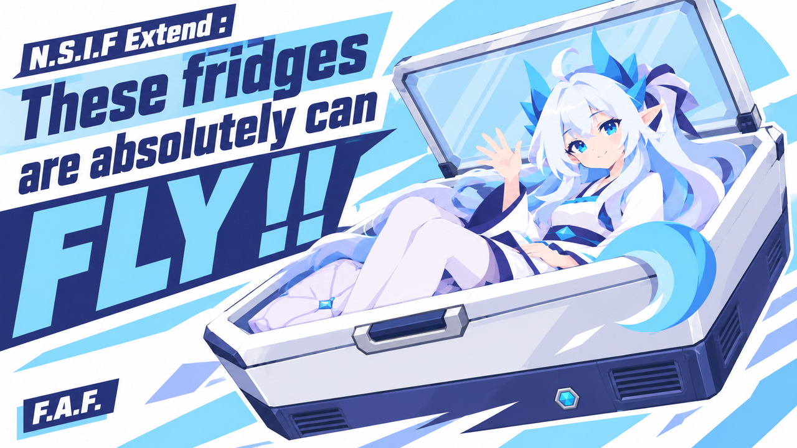

# F.A.F. — Fridges Absolutely Fly

**English** | [简体中文](README.zh-CN.md)

## AI Content Disclosure

**AI-generated art, writing and code—with human direction throughout.**

The human maintainer guides the design, revises the content, playtests the mod and makes the final release decisions.

**N.S.I.F Extend : These fridges are absolutely can FLY !!**

The Nivarian engineering team has determined that the floor is not an essential refrigeration component.

After **Project T.O.F.U**, fridges recognized by **Nivarian Sleep In Fridges** can hover in place and spin while airborne, as the little dragons inside continue sleeping. Hovering and rotation have separate controls, with a gentle lift-off and an orderly return to level before landing.

T.O.F.U research uses only ordinary steel and components. It also reduces the Nivarian household freezer's carried shell mass; stored goods and residents keep their full mass.

The mod also includes a Nivarian household freezer and a portable sleeping pad. Further improvements are filed under **SPICE — Storage Preservation and Integrated Cooling Engineering**. That the project list resembles a seasoning rack is an administrative coincidence.

## Installation

Install the runtime package, not GitHub's automatically generated source-code ZIP. Exit the game, extract `FAF_FridgesAbsolutelyFly` into `RimWorld/Mods`, and keep only one installed copy.

Enable in this order:

**Harmony → Humanoid Alien Races → Nivarian Race → Nivarian Sleep In Fridges QWQ → F.A.F.**

Supports **RimWorld 1.6 and 1.7**. **Odyssey is optional.** Fridge compatibility follows the prerequisite's recognition rules; T.O.F.U is required for hovering, including the included freezer.

## Feedback and documentation

- [Report a bug or suggest an improvement](https://github.com/Coahuilite/FridgesAbsolutelyFly/issues). Include your game version, mod version, reproduction steps and relevant errors; remove personal information from logs before sharing them.
- [English changelog](Docs/CHANGELOG.md) · [中文更新日志](Docs/CHANGELOG.zh-CN.md) — full changes, including later research effects and spoilers.
- [Mechanics guide in Chinese](Docs/MECHANICS.md) — contains later-game spoilers.
- [Development and release guide](Docs/DEVELOPMENT.md).

## License

Source code and software configuration marked MPL-2.0 use the [Mozilla Public License 2.0](LICENSE). Visual assets have separate bundled-use permission, not an MPL grant or a standalone redistribution license; see [licensing and third-party notices](Mod/THIRD_PARTY_NOTICES.md).

## Credits

Visual assets: GPT Images 2.5 (OpenAI)

[Asset provenance](Docs/ASSETS.md) · [Third-party notices](Mod/THIRD_PARTY_NOTICES.md). External reference illustrations are not redistributed.
